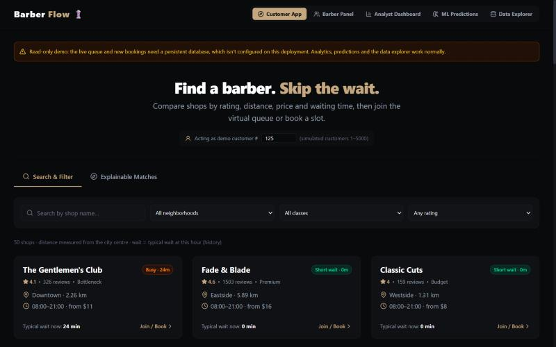
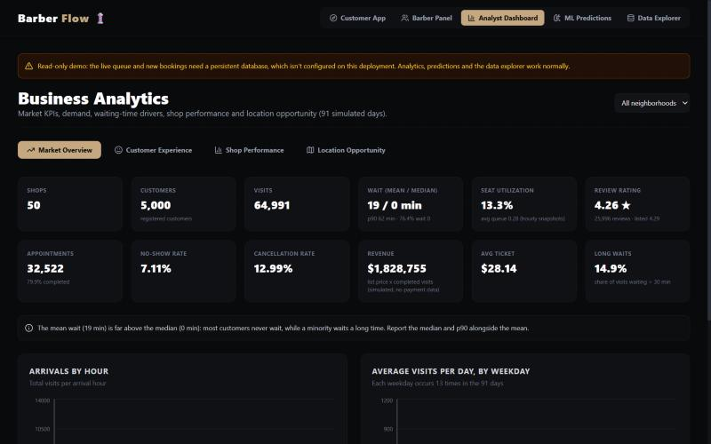
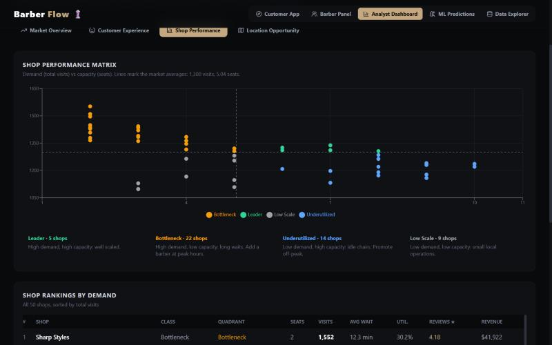
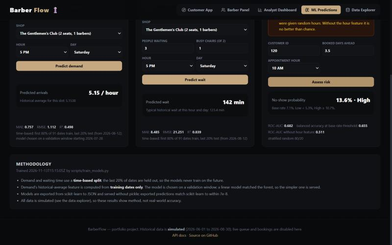
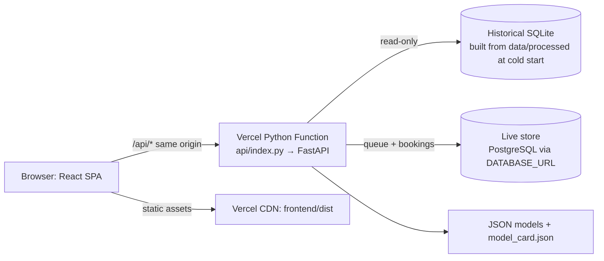

# BarberFlow 💈
### Barber-shop discovery, live virtual queue, SQL analytics & ML on a simulated market

**Live app:** https://barberflow-nu-one.vercel.app · **API docs:** https://barberflow-nu-one.vercel.app/api/docs · **Health:** https://barberflow-nu-one.vercel.app/health

> The public deployment is a **read-only demo**. Discovery, recommendations, all analytics, ML predictions and the data explorer work. Joining the queue and booking are disabled (the UI says so), because no persistent database is attached. [Run it locally](#run-locally) for the full live queue, or add Postgres ([Deploy](#deploy-vercel), step 2) to enable it online.

BarberFlow connects three users through one data platform:

- **Customers** compare shops by rating, distance, price and waiting time. They can join a virtual queue or book a slot.
- **Barbers** run a persisted live queue (start, finish, skip, walk-ins) and get rule-based recommendations.
- **Analysts** explore market KPIs, demand and wait drivers, shop quadrants, location opportunity and ML predictions.

> **Data honesty.** The 91-day history (50 shops, 5,000 customers, 64,991 visits, 2026-06-01 → 2026-08-30) is **simulated** by a discrete-event queue model in `scripts/generate_data.py`. Analytics describe that simulated market. The live queue and bookings you create in the app are real database writes.

---

## Screenshots

| Customer App | Analyst: market overview |
|---|---|
|  |  |
| **Analyst: shop performance matrix** | **ML predictions with measured metrics** |
|  |  |

## Features

| Area | What works |
|---|---|
| Customer App | Search and filters (area, class, rating), haversine distance from the city centre, an explainable ranking with adjustable weights and a per-factor breakdown, shop modal with services, reviews and typical hourly wait, **join queue** and **book appointment** (validated: opening hours, service length, past dates, slot capacity = number of barbers) |
| Barber Panel | Live queue with persisted **Start → Finish / Skip**, walk-in check-in with the shop's real services, 10-second polling, upcoming bookings, KPIs (history), three data-driven recommendations, the last simulated day exactly as generated |
| Analyst Dashboard | 12 market KPIs (mean, median and p90 wait, utilisation, review rating, completion, no-show and cancellation rates, revenue, ticket) with an area filter; demand by hour and weekday; wait distribution and wait by hour; rating vs. experienced wait; demand-vs-capacity quadrant chart; location opportunity relative to the market average |
| ML Predictions | Demand, waiting time and no-show risk. Inputs are validated, and every metric shown is read from `model_card.json` |
| Data Explorer | Schema (types, PK, NOT NULL), foreign keys, paged raw rows for all 7 tables (whitelisted, read-only) |

## Architecture



* **Why two stores?** The simulated history is the analytical source of truth and must not change. Vercel's filesystem is read-only, so the 18 MB SQLite DB is rebuilt from the committed CSVs on a cold start (about 0.8 s locally, 1.7 s measured on Vercel) and opened read-only. Writes (queue entries, bookings, rate-limit events) go to PostgreSQL (e.g. Neon). Without `DATABASE_URL`, the app runs as a **read-only demo**: the live features return HTTP 503 and the UI says so. It never writes to a temporary filesystem.
* **Locally**, the live store is a SQLite file (`backend/app/live.db`), so everything works with no setup.
* **Models** are trained with scikit-learn and exported to JSON (trees and coefficients). They are served in pure Python: no pickle, a small serverless bundle, and verified against scikit-learn to within 1e-7.

## Model performance (held-out data, simulated)

| Model | Algorithm | Test metrics | Status |
|---|---|---|---|
| Hourly demand | Linear Regression, chosen on a validation window over a Random Forest | MAE 0.76 customers/h, R² 0.50 (time split) | Baseline: matches the historical shop/hour/weekday average |
| Waiting time | Random Forest (100 trees, depth 10) | MAE 8.5 min, R² 0.84 (time split; mean baseline MAE 30.0) | Good on simulated data |
| No-show | Logistic Regression | ROC-AUC 0.68, balanced accuracy 0.655; AUC 0.51 without the hour feature | Experimental: no-shows are random in the simulator |

The source of truth is `backend/app/ml_models/model_card.json`, regenerated by `python scripts/train_models.py`.

## Tech stack

**Frontend:** React 19 · Vite 8 · Tailwind CSS v4 · Recharts · lucide-react
**Backend:** Python · FastAPI · Pydantic · sqlite3 · psycopg 3
**Data / ML:** pandas · NumPy · scikit-learn · Jupyter · Matplotlib/Seaborn
**Infra:** Vercel (static + Python Functions) · PostgreSQL (Neon) · pytest

## Run locally

Prerequisites: Python 3.12+ and Node.js 20+. Run each command from the repository root.

Install the backend dependencies:

```bash
python -m pip install -r requirements-dev.txt
```

Start the API on http://127.0.0.1:8000 (Swagger at /api/docs). It builds the SQLite DB automatically on first run:

```bash
python -m uvicorn backend.app.main:app --reload --port 8000
```

In a second terminal, start the frontend on http://127.0.0.1:5173 (Vite proxies /api to :8000):

```bash
cd frontend && npm install && npm run dev
```

Optional scripts:

```bash
python scripts/seed_db.py --force
```

```bash
python scripts/train_models.py
```

```bash
python scripts/export_powerbi.py
```

```bash
python -m pytest
```

These, in order: rebuild the historical DB from `data/processed`; retrain and export the models and `model_card.json`; refresh the Power BI CSVs in `powerbi/`; run the 18 API, SQL and data tests.

To run the same tests against PostgreSQL, set `BARBERFLOW_TEST_DATABASE_URL` to a **throwaway** database; its `live_*` tables are dropped first.

## Environment variables

| Variable | Default | Purpose |
|---|---|---|
| `DATABASE_URL` (or `POSTGRES_URL`) | unset | PostgreSQL live store. Required in production for the queue and bookings |
| `LIVE_DB_PATH` | `backend/app/live.db` | Local SQLite live store (development only) |
| `CORS_ORIGINS` | `http://localhost:5173,http://127.0.0.1:5173` | Allowed origins. Not needed on Vercel, where the UI and API share an origin |
| `WRITE_RATE_LIMIT` / `WRITE_RATE_WINDOW_MINUTES` | `30` / `10` | Per-client write limit (database-backed, works across serverless instances) |
| `MAX_ACTIVE_QUEUE_PER_SHOP` | `25` | Queue cap per shop |
| `RATE_LIMIT_SALT` | built-in | Salt for hashing client IPs (raw IPs are never stored) |
| `APP_TIMEZONE` | `America/New_York` | Local clock used for booking-date checks and the model's hour feature |

## Deploy (Vercel)

`vercel.json` builds `frontend/` into `frontend/dist`, serves `api/index.py` (FastAPI) for `/api/*` and `/health`, and falls back to `index.html` for the SPA. To deploy:

1. Import the GitHub repo in Vercel (root directory = repository root). The settings come from `vercel.json`.
2. *(For live queue and bookings)* add a Postgres database: **Storage → Create → Neon** in the Vercel dashboard. This injects `DATABASE_URL`. The tables are created automatically on first use.
3. Deploy, then check `/health` (`live_store.mode` should read `postgres`).

## Repository layout

```text
api/index.py             Vercel entry point → backend.app.main:app
backend/app/             FastAPI app: config, database (historical), live_store, domain, ml, routes/
backend/app/ml_models/   Exported models (JSON) + model_card.json
data/raw, data/processed Simulated CSVs (source of truth)
frontend/                React + Vite SPA (5 views)
notebooks/               Cleaning, EDA and original modelling notebooks
scripts/                 generate_data, seed_db, train_models, export_powerbi, compile_notebooks
sql/                     schema.sql, analysis_queries.sql (20 queries, all tested)
tests/                   pytest suite (SQLite and PostgreSQL)
powerbi/                 Star-schema CSV exports + analytics_summary.csv
```

## Known limitations

* **Simulated data:** insights show the method, not real customer behaviour. Customers are picked at random, so the repeat-client rate is about 1%.
* **Public demo is read-only:** the live queue and bookings need `DATABASE_URL`. Locally they use SQLite automatically.
* **No authentication:** when the live store is enabled, anyone can use the demo queue. Writes are rate-limited per client, capped per shop, validated, and isolated from the historical data.
* **Near-real-time only:** the barber panel polls every 10 s. Serverless functions don't hold WebSockets.
* **Location analysis** is area-level only (no maps, population or competitor data). Revenue is list price × visits (no payment data).
* **No-show model** is experimental (see the model table above). The demand model is a baseline.
